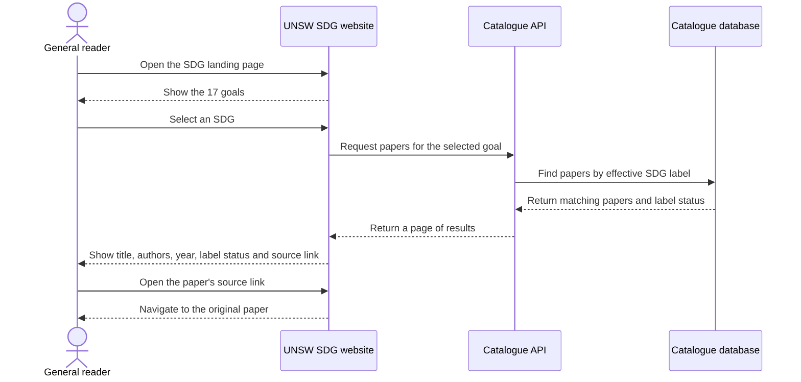
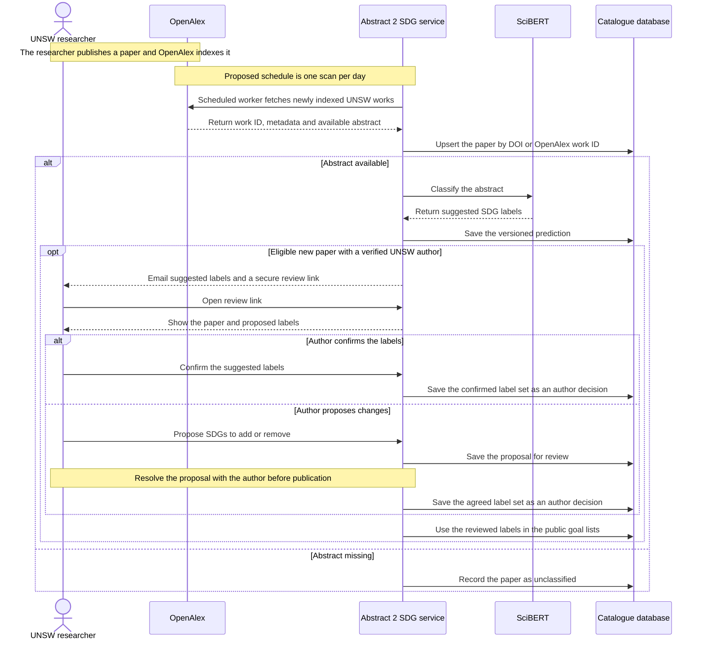
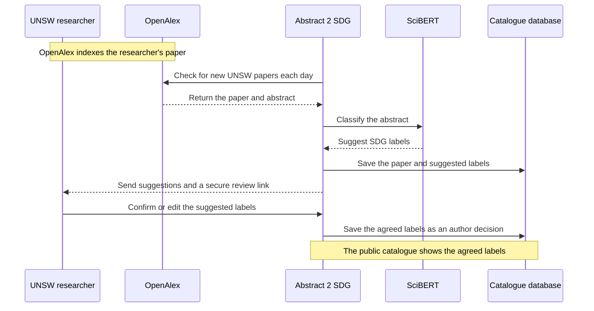
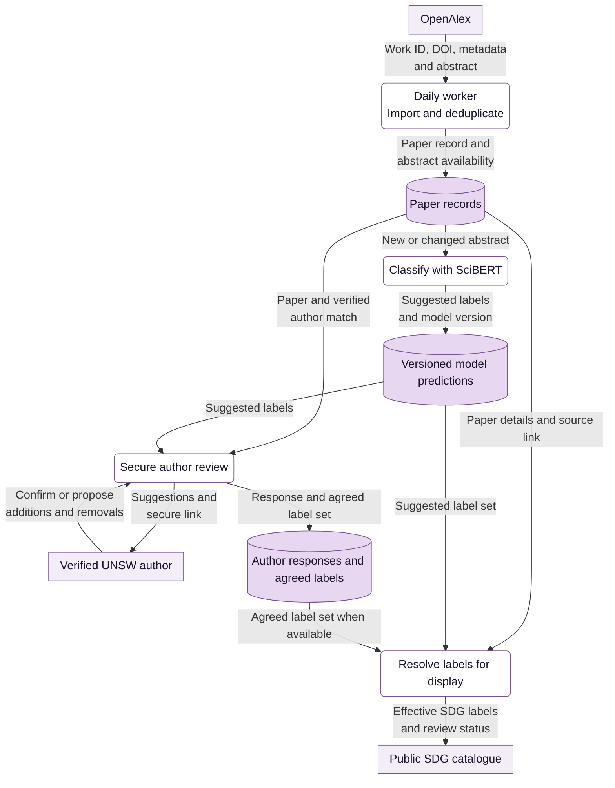

# Abstract 2 SDG — Website diagrams

These diagrams describe the proposed website in the [Thesis B implementation plan](next-phase-proposal.md).

## 1. Sequence diagram — A reader browses papers by SDG

## 2. Sequence diagram — A researcher reviews a newly published paper

On a later sync, a new prediction can be saved for a changed abstract. The catalogue continues to use the agreed label set for that paper.

### Presentation version

This sequence follows a paper with an available abstract through author review.

## 3. Data flow diagram — From SciBERT suggestions to reviewed labels

The catalogue shows model suggestions while review is pending and switches to the agreed label set once review is complete. Keeping predictions and author decisions separate preserves the author’s corrections when SciBERT runs again. Papers without abstracts remain unclassified. Historical imports populate the catalogue, and author invitations go to eligible newly indexed papers.
